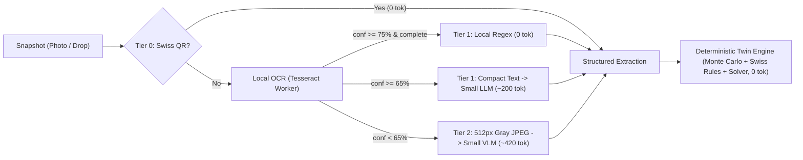

# Doppel — 3-Minute Demo Script, Jury Q&A & Slide Outline

**Targets:** UBS *AI Financial Twin* · AXA *Frugal use of Multimodal AI* (LauzHack 2026)

**Core conviction:** Never ask a language model to do arithmetic, and never send pixels to a cloud vision model when the browser already has the answer.

---

## 1. Three-minute stage script

### 0:00 – 0:25 · Hook & Behavioural Twin (UBS)
* Open Doppel on **Lukas, 31, Zürich** (CHF 142k gross, CHF 195k net worth, goal: CHF 1.6M by 50).
* Point straight to the hero number and the two lines on the cone chart:
  > *"Real Lukas has a **28%** chance of hitting CHF 1.6M by 50. A disciplined version of Lukas — same salary, same markets — sits at **69%**. That gap is **CHF 103'000** lost to his own habits: a **4.5× payday spending spike**, 4 subscriptions, and selling 60% of equities in drawdowns. Zero LLM calls ran to compute this — 1,000 monthly Monte Carlo paths executed in TypeScript in ~65 ms."*

### 0:25 – 1:05 · Snap a listing → Bank test fails → Find my path (UBS)
* Click the **Listing** sample (*4.5 Zimmer Wohnung, 8050 Zürich, CHF 940'000*).
* Show the timeline and the **Bank affordability test** card flipping red immediately:
  > *"Lukas doesn't type 40 fields. He snaps a flat listing. Local OCR reads 4.5 rooms, Zürich, CHF 940'000 and drops it onto his timeline. Swiss Tragbarkeit fails on the spot: **38.1%** of gross income against the 33.3% ceiling — CHF 20'638/yr short on gross income, max affordable price CHF 833'000. His goal odds fall from **28%** to **11%**."*
* Point to **Find my path** (inverse solver, ~250 ms, 0 tokens):
  > *"Instead of lecturing him, the solver searches the simulator backwards for the smallest concrete moves: buy 24 months later (passes the bank test), invest CHF 47k idle cash + max Pillar 3a (→ 56%), or cut CHF 820/mo (→ 80%). Click **Apply** — the cone updates instantly."*
* Type or speak one what-if in the command bar: *"What if I lose my job for 6 months in 2028?"*
  > *"Parsed locally by our intent parser: **0 tokens**, 2×1,000 futures re-run in ~65 ms. Free-form phrasing it doesn't recognise falls back to a tiny JSON-only LLM call."*

### 1:05 – 2:30 · The AXA Frugality Moment (Live Inspector + Live GPT-4o Check)
* Click the **⚡ badge** in the header to open the **Frugal Pipeline Inspector**.
* Walk through three documents in sequence so the jury watches the cascade escalate only when necessary:
  1. **Swiss QR-bill (`qr-bill.svg`, CHF 412.00):**
     > *"Tier 0: `jsQR` decodes the SIX QR payload right in the browser. Amount, IBAN, creditor, reference — **0 tokens, 0 bytes left the device, < 90 ms**."*
  2. **Supermarket receipt (`receipt.svg`, CHF 87.45) — or Payslip (`payslip.svg`, Nettolohn CHF 8'650):**
     > *"Tier 1: grayscale + percentile contrast stretch + Tesseract in a Web Worker. When OCR confidence is high and structure is clear, local regex resolves it at **0 tokens** (even disambiguating Swiss `Nettolohn` from `Bruttolohn`). Ambiguous printed text sends only ~200–600 characters of compressed text to a small text model — never the image."*
  3. **Handwritten sabbatical note (`note.svg`, "Sabbatical Japan, summer 2028, need ≈ 25k"):**
     > *"OCR confidence drops to 33%, below our 65% gate. Only now do we escalate to Tier 2: a **512px grayscale JPEG (~13 KB)** to a small vision model (~420 tokens)."*
* Expand one snap entry in the Inspector and click **"Run the naive way (GPT-4o)"**:
  > *"Don't trust our estimate — let's run the naive approach live right now. Original image straight to GPT-4o high-detail."*
  * Point to the side-by-side table: measured tokens, measured cost, latency, and **"Same amount"** confirmation.
* Note the honest accounting in the Inspector:
  > *"Notice our rules: offline fallbacks and failed extractions are separated out and **excluded** from headline savings. The baseline uses actual image dimensions — no synthetic upscaling."*

### 2:30 – 3:00 · Benchmark & Unit Economics Close
* Cite the 16-document benchmark (`docs/BENCHMARK.md`, clean + phone-photo degraded DE/FR/EN docs):
  > *"Across 16 clean and phone-degraded Swiss documents — rotated, skewed, blurred, warm-lit JPEGs — **69% (11/16)** resolve locally at **0 tokens** with **11/11** accuracy. Average tokens drop from **1,088** to **118** (**−89%**), and cost drops from **$3.62** to **$0.02 per 1,000 snaps** (**−99.5%**). For a bank with 100,000 users snapping 20 docs a month, that is **$37/month instead of $7,238/month** — and 100% deterministic, auditable financial maths."*

---

## 2. Likely jury questions & crisp answers

**Q: Why not just send everything to GPT-4o (or GPT-4o-mini) and save engineering time?**
> Three reasons: **cost at scale**, **latency**, and **privacy**. Even against a cheaper frontier model, sending full-resolution photos for every Swiss QR-bill and supermarket receipt wastes 700–1,400 image tokens per document on data that is already encoded in a QR code or clean printed text. On 100k users × 20 snaps/mo, our cascade costs **~$37/mo** vs **~$7,238/mo** on GPT-4o high-detail (and even against GPT-4o-mini, Tier 0 + local regex still cut 69% of cloud calls to literally zero bytes and zero cost).

**Q: What is the accuracy vs. cost trade-off — where does the cascade fail?**
> We tested it on 16 docs including heavily degraded phone photos (`docs/BENCHMARK.md`). Tier 0 + local-regex got **11/11 (100%)** on documents that cleared the confidence gate (≥ 75% OCR + required fields). The 4 hard documents — cursive handwriting (`note-clean`, `note-photo-desk`), a severely blurred low-res QR-bill (`qr-bill-photo-lowres`, OCR 38%), and a dim 480px receipt (`receipt-photo-dim`, OCR 34%) — all dropped cleanly below our 65% gate and escalated to Tier 2 (512px gray JPEG → small VLM). The gate catches bad OCR rather than silently passing garbage to regex.

**Q: Privacy — what actually leaves the user's device?**
> You can inspect every byte in the Frugal Inspector.
> * **Tier 0 (QR-bill), Tier 1 local-regex, local what-ifs, Monte Carlo, Swiss mortgage checks, behavioural analysis, inverse solver:** **0 bytes** leave the browser.
> * **Tier 1 text-LLM (ambiguous printed text):** only the ≤ 600-character filtered OCR lines, never the photo.
> * **Tier 2 vision-LLM (handwriting / bad photo):** a 512px grayscale JPEG (~11–20 KB), never the original high-res photo.
> * **Private banker narration (opt-in):** ~10 aggregate summary numbers — never raw transaction rows or IBANs.

**Q: What if Tesseract OCR fails completely or returns wrong numbers with high confidence?**
> First, Tesseract's mean word confidence drops sharply on handwriting (28–33%) and motion blur (34–38%), which triggers Tier 2 vision automatically. Second, `local-regex` only accepts an extraction when **both** OCR confidence ≥ 75% **and** document-specific structural fields exist (e.g. a listing needs a price ≥ CHF 50k plus rooms or postal location; a payslip explicitly matches `Nettolohn`/`Salaire net` and rejects `Bruttolohn`/`Total Abzüge`). If a field is missing, it escalates to `text-llm` or marks the entry `partial` with `fieldsMissing` so the user sees what wasn't read.

**Q: How do we know your "−89% tokens / −99.5% cost" isn't an inflated benchmark?**
> Two safeguards: (1) Our naive baseline uses each image's **actual** pixel dimensions (no upscaling) with OpenAI's documented 512² tile formula + realistic 160-token prompt / 120-token JSON output, and our reasoning baseline caps twin state at 2.4k chars rather than dumping raw transactions. (2) Any judge can click **"Run the naive way (GPT-4o)"** inside the Inspector on any snapped document to replace the estimate with a live measured GPT-4o API call on the spot. Offline fallbacks and failed extractions are excluded from headline savings.

---

## 3. Three-slide deck outline

### Slide 1 · Problem: Two broken defaults
* **For users (UBS):** Financial planning dies at onboarding — nobody types 40 numbers, and static calculators ignore *human behaviour* (Lukas's payday spike + panic-selling cost him CHF 103k and drop his odds from 69% to 28%).
* **For engineering (AXA):** The default AI reflex — throwing 2048px phone photos and full financial histories at a frontier VLM — is slow, leaks sensitive personal documents, burns ~$7.2k/mo per 100k users, and lets an LLM hallucinate mortgage maths.
* **Doppel:** Feed a deterministic Swiss financial twin straight from snapshots, escalating to the cloud only when the browser genuinely can't read the document.

### Slide 2 · Architecture: Cascade first, code does the maths

```
Phone photo / drop
  ├─► Tier 0: multi-scale jsQR ──► Swiss QR-bill (SIX) ──────────► 0 tok, 0 B sent
  ├─► SHA-256 local cache hit ───────────────────────────────────► 0 tok, 0 B sent
  ├─► Grayscale + 2–98% stretch + Tesseract (eng+deu, worker)
  │     ├─► conf ≥ 75% + complete schema ─► local regex (DE/FR/EN) ► 0 tok, 0 B sent
  │     ├─► conf ≥ 65% (ambiguous / note) ─► ≤600 ch ─► small LLM  ► ~200 tok
  │     └─► conf < 65% (handwriting/blur) ─► 512px gray JPEG (~15 KB) ─► small VLM (~420 tok)
  ▼
Deterministic Twin Engine (TypeScript, in-browser, 0 tokens, ~65 ms)
  • 1,000-path Monte Carlo (Real you vs Disciplined you)
  • Swiss Tragbarkeit (20%/10% equity, 5% stress + 1% upkeep + amort ≤ ⅓ gross)
  • Inverse Goal Solver ("Find my path": spend / invest / delay)
```



### Slide 3 · Proof: 16-doc benchmark & live verification
* **Benchmark (`docs/BENCHMARK.md`, 16 DE/FR/EN clean + phone-degraded docs):**
  * **69% (11/16)** resolved locally at **0 tokens** with **11/11 (100%)** amount accuracy.
  * **118 tok/doc** vs **1,088 tok/doc** naive GPT-4o (**−89.2% tokens**).
  * **$0.02 / 1,000 snaps** vs **$3.62 / 1,000 snaps** naive (**−99.5% cost**).
  * **100k users × 20 snaps/mo:** **$37/mo** vs **$7,238/mo** naive (rough energy: ~25 Wh vs ~653 Wh per 1,000 snaps).
* **Zero hand-waving on stage:** Live **"Run the naive way (GPT-4o)"** button inside the Frugal Inspector replaces estimates with measured API usage and checks extracted-amount parity.
